# Informe — ¿Quién protege la memoria?

- **Usuario:** Juan David Cardozo Fajardo
- **Fecha:** `2026-11-02`
- **Versiones:** ver `EVIDENCIAS/versions.txt`. Observado: gcc 13.3.0,
  clang 18.1.3, rustc 1.90.0 (estable), nightly rustc 1.92.0-nightly
  (2025-09-14) con miri 0.1.0, OpenJDK 21. Imagen `lab-memoria:1.0`
  (Ubuntu 24.04).

  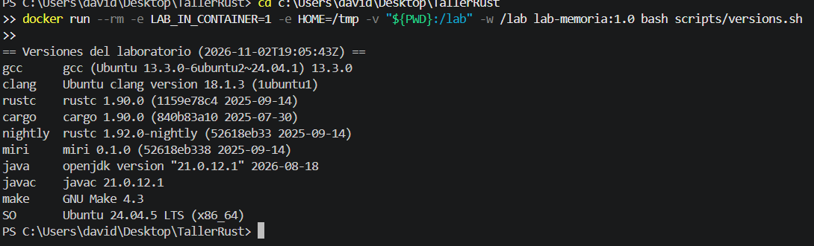
- **Entorno de ejecución:** host Windows + Docker Desktop. Como `make` usa
  `id -u`/`-t` (no disponibles en PowerShell), ejecuté los scripts del
  laboratorio directamente dentro del contenedor con
  `docker run --rm -e LAB_IN_CONTAINER=1 -v "${PWD}:/lab" -w /lab lab-memoria:1.0 bash <script>`,
  que es exactamente lo que hace cada objetivo de `make`. Los `.sh` se
  normalizaron a fin de línea LF (el clon en Windows los dejó en CRLF y bash
  fallaba con `$'\r'`).

> Nota sobre las predicciones: la columna **Predicción** se escribió **antes**
> de correr cada caso. Sin embargo, toda la entrega (predicciones y resultados)
> se subió al repositorio en un **único commit**, por lo que el historial de git
> no sirve como prueba del orden temporal: no puedo demostrar con el repo que las
> predicciones se registraran antes de ejecutar. El **Resultado observado**
> proviene de la ejecución dentro del contenedor (`make m1/m2/m3/minivec`), con
> el comando exacto y el archivo de `EVIDENCIAS/` indicados en cada sección.

> Nota sobre comportamiento indefinido (UB): los casos de C con `-O0`/`-O2` no
> producen un "dato estable". El valor impreso puede variar entre compilador,
> nivel de optimización y ejecución. Solo los sanitizers (ASan/UBSan/TSan) y
> Miri dan una señal fiable de que existe el defecto.

---

## 1. Experimento 1 — Límites y comportamiento indefinido

| Caso | Predicción | ¿Compila? | ¿Cuándo se detecta? | Resultado observado | ¿Qué garantía aporta? |
| --- | --- | --- | --- | --- | --- |
| C, índice calculado (a `-O0`, b `-O2 -Wall -Wextra`, c `-g -O1 -fsanitize=address`) | (a) compila, imprime basura o crashea, no fiable; (b) compila, posiblemente sin warning por índice calculado; (c) ASan reporta stack-buffer-overflow | Sí | (a)(b) en ejecución, no fiable (UB); (c) en ejecución con ASan | Observado: (a) imprimió `32765`, (b) `32767` (valores distintos → UB, no estable); (c) ASan: `stack-buffer-overflow ... READ of size 4 ... 'values' <== overflows this variable`, abortó | Ninguna garantía del lenguaje; solo ASan detecta el acceso fuera de límites |
| Rust, constante (`v[5]`) | No compila: lint `unconditional_panic` (deny) | No | En compilación (lint) | Observado: `error: this operation will panic at runtime ... index out of bounds: the length is 5 but the index is 5`, con `#[deny(unconditional_panic)]`; no compila | El compilador prueba que ese índice constante siempre haría panic |
| Rust, calculado (`get` y `[]`) | `v.get(i)` → `None`; `v[i]` → panic "index out of bounds" | Sí | En ejecución | Observado: `v.get(i)` imprimió `None`; `v[i]` hizo `panicked ... index out of bounds: the len is 5 but the index is 5` (código 101) | Comprobación de límites en ejecución; nunca acceso fuera de rango |
| Rust, `get_unchecked` (debug / release / Miri) | debug: posible abort "unsafe precondition violated" (rustc ≥1.78); release: UB, no estable; Miri: reporta "Undefined Behavior" | Sí | debug: ejecución; release: no detectado; Miri: ejecución | Observado: debug abortó con `unsafe precondition(s) violated: slice::get_unchecked requires that the index is within the slice` (código 134); release abortó con `Illegal instruction` (código 132, UB no estable); Miri: `Undefined Behavior: ` + "`assume` called with `false`" | `unsafe` traslada la obligación al programador; solo Miri confirma el UB de forma fiable |
| Java, arreglo de 5 (`Bounds.java`) | `ArrayIndexOutOfBoundsException` ("Index 5 out of bounds for length 5") | Sí | En ejecución (excepción) | Observado: `ArrayIndexOutOfBoundsException: Index 5 out of bounds for length 5` (código 1) | Comprobación de límites del runtime de la JVM |
| Overflow C / Rust / Java | C: UB; clang+UBSan reporta "signed integer overflow", gcc puede plegar `x+1>x`→1 y ocultarlo. Rust: debug panic "attempt to add with overflow", release envuelve a `-2147483648`. Java: línea 1 envuelve (−2147483648), `Math.addExact` lanza `ArithmeticException` | Sí (todos) | C: ejecución con UBSan; Rust: debug ejecución / release nunca; Java: ejecución (solo `addExact`) | Observado — C: gcc `-O0`/`-O2`/UBSan imprimieron `1` (gcc plegó `x+1>x`→1, UBSan no vio la suma); clang `-O0` imprimió `0`, clang+UBSan reportó `runtime error: signed integer overflow: 2147483647 + 1 cannot be represented in type 'int'`. Rust: debug `panicked ... attempt to add with overflow` (código 101); release imprimió `-2147483648`. Java: `-2147483648` (wrap) y luego `ArithmeticException: integer overflow` en `Math.addExact` | C: ninguna (UB); Rust debug: panic defensivo; Java: wrap definido + chequeo opcional explícito |

**Comandos y evidencias:**

```bash
make versions > entregas/fajardojuan402-pixel/EVIDENCIAS/versions.txt
make m1 2>&1 | tee entregas/fajardojuan402-pixel/EVIDENCIAS/m1.txt
```

> `m1.txt` ya incluye la comparación gcc vs clang en `overflow.c`: el script
> `run-expect-fail.sh` compila ese caso con **ambos** compiladores en la misma
> ejecución (gcc imprime `1` por el plegado de `x+1>x`, clang imprime `0` y su
> UBSan reporta el overflow). No se generó un `m1-clang.txt` aparte. Si se
> quisiera forzar clang también en el resto de casos del módulo:
> `make m1 CC=clang 2>&1 | tee entregas/fajardojuan402-pixel/EVIDENCIAS/m1-clang.txt`.

**Análisis.**

- **¿Qué mecanismo detecta el índice constante en Rust y por qué no prueba que
  todo índice sea válido?** Lo detecta el lint `unconditional_panic` en tiempo
  de compilación: como el índice `5` y la longitud `5` son constantes, el
  compilador evalúa que `v[5]` *siempre* entraría en pánico y lo convierte en
  error (es `deny` por defecto). Es una prueba sobre un valor conocido en
  compilación; no se generaliza a un índice `i` calculado en ejecución, porque
  ahí el valor no se conoce estáticamente. Para ese caso Rust inserta una
  comprobación de límites en ejecución.

- **¿Por qué `get_unchecked` es UB y `v[i]` no?** `v[i]` (el operador `Index`)
  siempre comprueba `i < len` y, si falla, hace panic de forma determinista:
  nunca lee fuera del buffer. `get_unchecked` es `unsafe` y **omite** esa
  comprobación; su contrato (precondición) exige que el llamante garantice
  `i < len`. Al pasarle `i == len` se lee memoria fuera de los elementos
  inicializados: eso es comportamiento indefinido. El compilador no lo impide
  porque el programador firmó el contrato con `unsafe`. Miri, que interpreta el
  programa con un modelo de memoria estricto, sí observa el acceso inválido.

- **¿Qué semántica de overflow elige cada lenguaje y por qué el compilador de C
  puede "optimizar" la comparación?** En C, el overflow de enteros con **signo**
  es UB; el estándar permite al compilador asumir que *nunca ocurre*. Por eso
  gcc puede razonar "`x + 1 > x` es siempre verdadero" y plegar la función a
  `return 1` sin ejecutar la suma, de modo que UBSan ya no "ve" el overflow.
  clang, en cambio, suele conservar la suma y UBSan la detecta. Rust define el
  overflow como **error** en debug (panic con `overflow-checks`) y como
  **wrap** de complemento a dos en release (comportamiento definido, no UB).
  Java define el `int` como complemento a dos que **envuelve** siempre
  (`Integer.MAX_VALUE + 1 == Integer.MIN_VALUE`); si se quiere detección hay que
  pedirla explícitamente con `Math.addExact`, que lanza `ArithmeticException`.

**Tarea propia.** Escribí `modulos/m1-limites/java/Bounds.java` (arreglo de 5
leído en el índice 5). El script `run-expect-fail.sh` lo ejecuta si existe y
espera `ArrayIndexOutOfBoundsException`.

**Evidencias visuales.**

C — índice fuera de rango con ASan (`stack-buffer-overflow`):

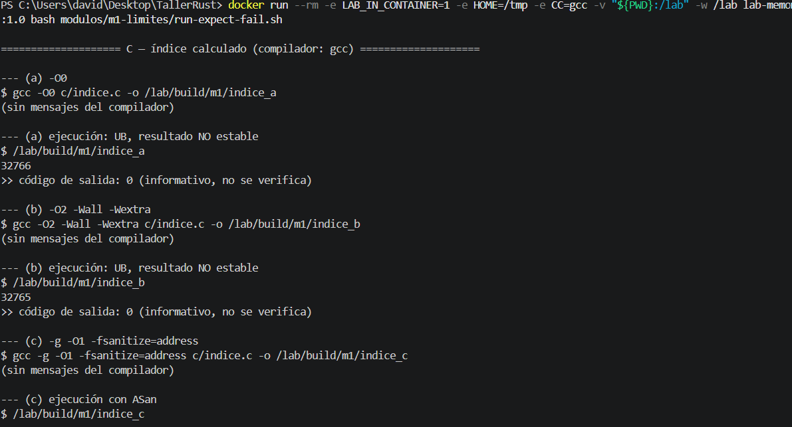

C — mismo índice en `-O0` vs `-O2`: valores distintos (UB no estable):

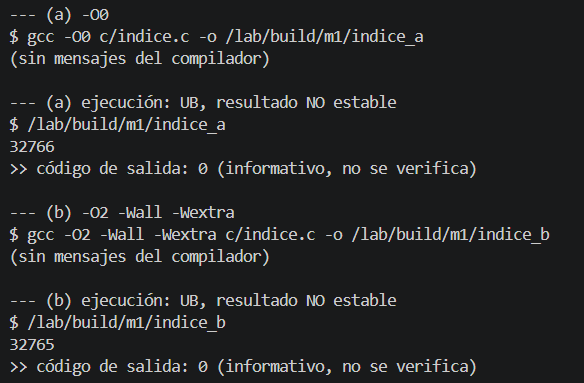

Rust — índice constante: no compila (`unconditional_panic`):

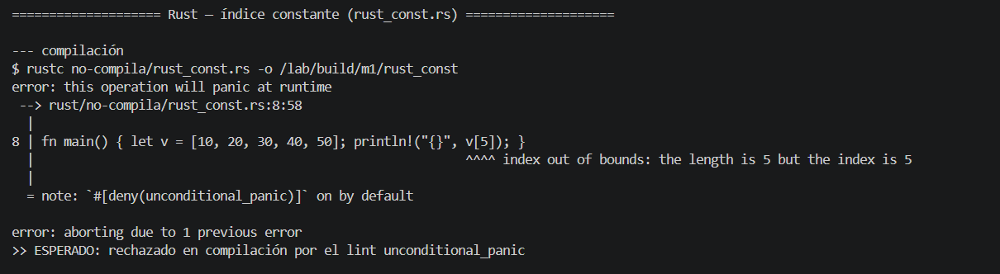

Rust — índice dinámico: `get` → `None`, `[]` → panic index out of bounds:

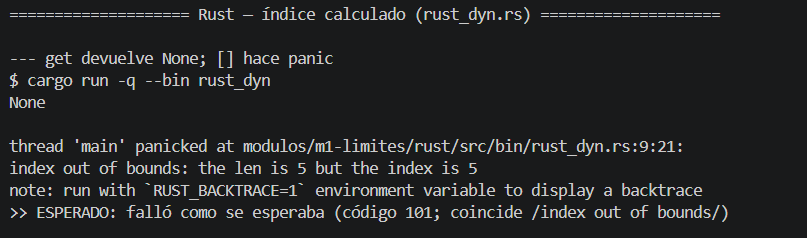

Rust — `get_unchecked` bajo Miri: Undefined Behavior:

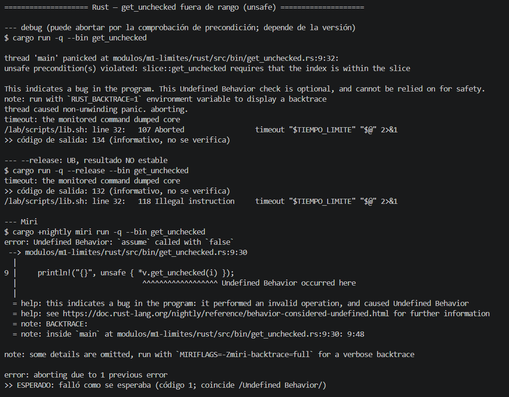

C — overflow: gcc pliega la comparación (`1`) vs clang (`0`):

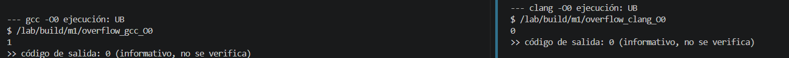

Java — overflow: wrap en la primera línea y `ArithmeticException` con `addExact`:

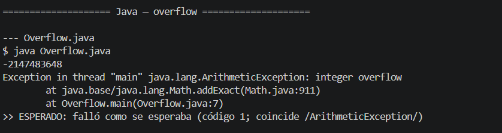

---

## 2. Ownership y dónde termina la garantía

### Puzzle A — move (`rust/no-compila/a_move.rs`)

- **Mensaje del compilador y propiedad violada:** error **E0382**, "borrow of
  moved value: `first`". `String` no es `Copy`; `let second = first;` **mueve**
  la propiedad del buffer de `first` a `second`, y usar `first` luego viola la
  regla de que cada valor tiene un único dueño vivo. Garantiza que no haya dos
  dueños del mismo heap (evita doble free / use-after-free).

- **Corrección con borrowing (código) y justificación:**

  ```rust
  fn main() {
      let first = String::from("Hola");
      let second = &first;              // préstamo compartido, no se mueve
      println!("{first} {second}");
  }
  ```
  `second` toma una referencia inmutable; `first` conserva la propiedad y sigue
  siendo válido. Coste: ninguno en memoria (no copia datos), pero `second` queda
  atado al tiempo de vida de `first`.

- **Corrección con clonación (código) y justificación:**

  ```rust
  fn main() {
      let first = String::from("Hola");
      let second = first.clone();       // copia profunda e independiente
      println!("{first} {second}");
  }
  ```
  `clone()` duplica el buffer en el heap; ahora hay dos dueños independientes.
  Coste: una asignación y copia de bytes adicional.

- **Comparación de semántica y costo:** el préstamo es O(1) y sin asignación,
  pero crea una dependencia de tiempo de vida (el préstamo no puede sobrevivir
  al dueño). La clonación es independiente pero paga asignación + copia. Se
  prefiere borrowing salvo que se necesiten dos valores con vidas separadas o
  mutación independiente.

- **¿Qué habría pasado en C y en Java?** En **C**, `second = first` copia el
  puntero; ambos apuntan al mismo buffer y al liberar uno queda un
  *dangling pointer* (doble free o use-after-free si se libera dos veces): UB
  silencioso. En **Java** no hay propiedad: `second = first` copia la referencia,
  ambos ven el mismo objeto y el GC lo libera cuando nadie lo alcanza; no hay
  error, pero tampoco aislamiento (mutaciones por una referencia se ven por la
  otra).

### Puzzle B — mutar mientras se itera (`rust/no-compila/b_push_iter.rs`)

- **Mensaje del compilador y propiedad violada:** error **E0502**, "cannot
  borrow `v` as mutable because it is also borrowed as immutable". El bucle
  `for x in &v` mantiene un préstamo **compartido** de `v`; `v.push(4)` necesita
  un préstamo **mutable** simultáneo. Rust prohíbe tener a la vez un préstamo
  mutable y uno compartido (regla de aliasing XOR mutación). Esto evita que
  `push` reubique el buffer e invalide el iterador (puntero colgante).

- **Corrección mínima (código) y justificación:**

  ```rust
  fn main() {
      let mut v = vec![1, 2, 3];
      let mut nuevos = Vec::new();
      for x in &v {
          if *x == 2 { nuevos.push(4); }   // acumula aparte
      }
      v.extend(nuevos);                    // muta cuando ya no hay préstamo activo
  }
  ```
  Se separa la lectura (iteración) de la mutación: mientras se itera no se toca
  `v`, y la inserción ocurre cuando el préstamo compartido ya terminó.

- **Java: `ConcurrentModificationException`: ¿qué detecta y cuándo, frente a
  Rust?** Tras completar el TODO (añadir `4` cuando `x == 2`), Java lanza
  `ConcurrentModificationException` **en ejecución**: el iterador de `ArrayList`
  lleva un contador `modCount` y detecta que la lista cambió de estructura
  durante la iteración. Es la misma clase de defecto que Rust rechaza, pero Java
  lo descubre tarde (en runtime, probabilísticamente según el camino de
  ejecución) mientras que Rust lo rechaza en compilación de forma total.

### RefCell (`rust/src/bin/refcell.rs`)

- **Predicción y resultado:** predicción → compila, pero hace **panic** en el
  segundo `borrow_mut()` con `BorrowMutError` ("already borrowed").
  Resultado observado: ver `EVIDENCIAS/m2.txt`.

- **Qué comprobó el compilador / qué comprueba RefCell en ejecución:** el
  compilador solo verificó los tipos; `RefCell` traslada la regla de aliasing
  (un solo préstamo mutable a la vez) a una comprobación **dinámica** mediante un
  contador de préstamos. El segundo `borrow_mut()` ve que ya hay uno activo y
  entra en pánico.

- **Por qué el panic es preferible a un acceso indefinido, pero no equivale a una
  garantía estática:** el panic es determinista, seguro en memoria y aborta antes
  de corromper nada; es mucho mejor que el aliasing mutable incontrolado de C
  (UB). Pero ocurre en ejecución y solo en el camino que efectivamente se toma:
  no demuestra, como sí hace el borrow checker estático, que el error no pueda
  suceder en ninguna ejecución. `RefCell` marca dónde **termina** la garantía
  estática de Rust.

- **Fugas: `Rc` cíclico en Rust y caché estático en Java:** un ciclo de
  `Rc<RefCell<...>>` que se referencia a sí mismo nunca llega a cuenta 0, así que
  su memoria no se libera: es una **fuga** segura en memoria (no es UB, pero
  desperdicia recursos) y se rompe usando `Weak`. En Java, `CacheEstatico`
  guarda buffers de 1 MiB en una lista `static` que nunca se vacía: el GC solo
  libera objetos **inalcanzables**, y estos siguen alcanzables desde el caché.
  Con `-Xmx128m` termina en `OutOfMemoryError`. En ambos casos el lenguaje es
  memory-safe pero la **retención lógica** de objetos no la detecta nadie
  automáticamente: es responsabilidad del diseño.

**Comandos y evidencias:**

```bash
make m2 2>&1 | tee entregas/fajardojuan402-pixel/EVIDENCIAS/m2.txt
# A mano, dentro del contenedor:
#   rustc no-compila/a_move.rs       -> E0382
#   rustc no-compila/b_push_iter.rs  -> E0502
#   cargo run                        -> panic BorrowMutError
#   java ForEach.java                -> ConcurrentModificationException
#   java -Xmx128m CacheEstatico.java -> OutOfMemoryError
```

**Evidencias visuales.**

Puzzle A — move (`error[E0382]`):

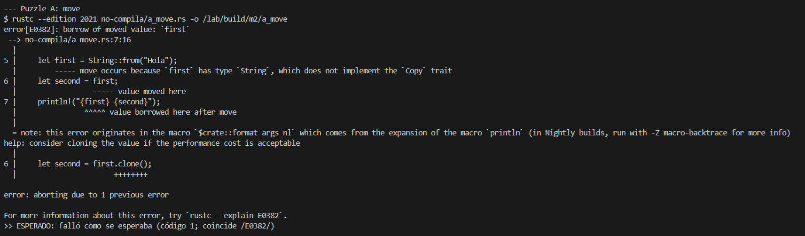

Puzzle B — mutar al iterar (`error[E0502]`):

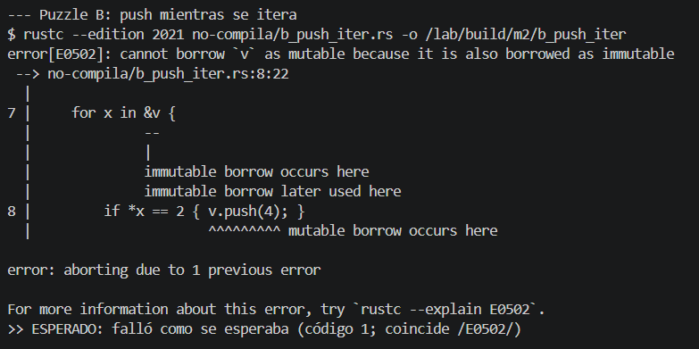

RefCell — panic en ejecución (`already borrowed`):

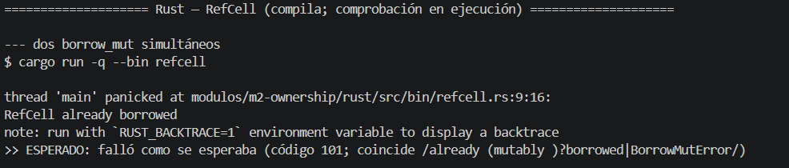

Java — `ConcurrentModificationException` (con el TODO completado):

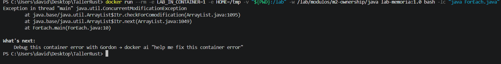

Java — caché estático: crecimiento del heap y `OutOfMemoryError`:

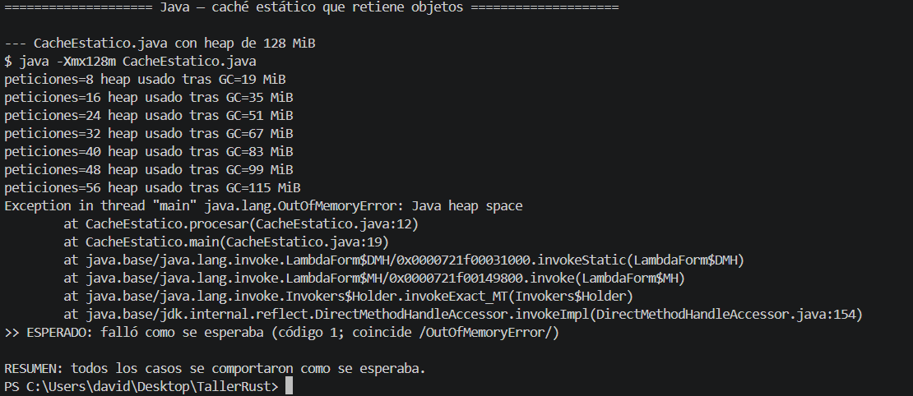

---

## 3. Concurrencia

| Programa | Clasificación | ¿Qué lo detecta? | Evidencia |
| --- | --- | --- | --- |
| Java `Carrera` | Error lógico (lost update); **no** es UB | Nada automático; se observa como resultado < 400000 e inestable | `EVIDENCIAS/m3.txt` |
| C `carrera.c` (TSan) | Data race = **UB** | ThreadSanitizer: `data race ... global 'contador' ... in trabajar` (ver nota de entorno) | `EVIDENCIAS/m3-tsan.txt` |
| Rust `Rc` entre hilos | No compila (defecto de diseño rechazado) | Compilador: error **E0277** (`Rc` no es `Send`) | `EVIDENCIAS/m3.txt` |
| Rust dos `Mutex` | Deadlock; es memory-safe pero no termina | `timeout` (código de salida 124); ni compilador ni sanitizer | `EVIDENCIAS/m3.txt` |

- **Dispersión observada de `Carrera.java` y corrección con `AtomicInteger`:**
  cuatro hilos hacen `contador++` (leer-sumar-escribir, no atómico) 100 000
  veces cada uno. El total correcto sería 400 000, pero las 5 ejecuciones
  dieron valores menores y distintos: **125611, 400000, 139588, 215207,
  187659** (`EVIDENCIAS/m3.txt`): 4 de 5 perdieron incrementos. La corrección
  con `AtomicInteger` da **400000** de forma estable en las 3 ejecuciones de
  verificación (`EVIDENCIAS/correcciones-verif.txt`). Código:

  ```java
  import java.util.concurrent.atomic.AtomicInteger;
  public class Carrera {
      static final AtomicInteger contador = new AtomicInteger(0);
      public static void main(String[] a) throws Exception {
          Thread[] ts = new Thread[4];
          for (int i = 0; i < 4; i++) {
              ts[i] = new Thread(() -> { for (int j = 0; j < 100_000; j++) contador.incrementAndGet(); });
              ts[i].start();
          }
          for (Thread t : ts) t.join();
          System.out.println(contador.get());   // siempre 400000
      }
  }
  ```
  `incrementAndGet()` es una operación atómica (read-modify-write indivisible),
  así que no hay actualización perdida.

- **Por qué la data race es UB en C y no en Java:** el estándar de C deja el
  acceso concurrente no sincronizado a la misma variable como **comportamiento
  indefinido**: el compilador puede reordenar, cachear en registros o asumir que
  no hay carrera, y el resultado no tiene significado. El modelo de memoria de
  Java sí define semántica para accesos con carrera (no es UB): el valor es
  impredecible pero acotado, el programa sigue siendo memory-safe y no corrompe
  la VM. El resultado es igual de **incorrecto**, pero en C además es inseguro.

- **Corrección del deadlock con orden global de adquisición (código):** el
  deadlock surge porque `t1` toma `a` y luego `b`, mientras `t2` toma `b` y luego
  `a`. Si **todos** los hilos adquieren los mutex en el mismo orden global, no
  puede haber espera circular:

  ```rust
  use std::{sync::{Arc, Mutex}, thread, time::Duration};
  fn main() {
      let (a, b) = (Arc::new(Mutex::new(0)), Arc::new(Mutex::new(0)));
      let (a1, b1) = (a.clone(), b.clone());
      let t1 = thread::spawn(move || {
          let _x = a1.lock().unwrap(); thread::sleep(Duration::from_millis(100));
          let _y = b1.lock().unwrap();          // orden: a, luego b
      });
      let t2 = thread::spawn(move || {
          let _x = a.lock().unwrap(); thread::sleep(Duration::from_millis(100));
          let _y = b.lock().unwrap();           // mismo orden: a, luego b
      });
      t1.join().unwrap(); t2.join().unwrap();    // ahora SÍ termina
  }
  ```
  Verificado: el binario original queda bloqueado y `timeout 5` lo mata
  (código 124 en `EVIDENCIAS/m3.txt`); la versión corregida imprime
  "terminado sin deadlock" y sale con código 0
  (`EVIDENCIAS/correcciones-verif.txt`, fuente en `correcciones/deadlock_fix.rs`).

- **Nota de entorno (TSan).** En la ejecución normal de `make m3` (sin
  privilegios) TSan **no pudo** ejecutar `carrera.c`: abortó con
  `FATAL: ThreadSanitizer: unexpected memory mapping` porque el ASLR del kernel
  de la VM de Docker Desktop sigue activo (ver `EVIDENCIAS/m3.txt`). `--privileged`
  por sí solo **tampoco** bastó (mismo fallo). Sí se logró reproducir
  desactivando ASLR por proceso con `setarch -R` dentro de un contenedor
  privilegiado:

  ```bash
  docker run --rm --privileged --cap-add SYS_PTRACE -e LAB_IN_CONTAINER=1 \
    -e HOME=/tmp -v "${PWD}:/lab" -w /lab/modulos/m3-concurrencia lab-memoria:1.0 \
    bash -c "gcc -g -O1 -fsanitize=thread -pthread c/carrera.c -o /tmp/carrera_tsan \
             && setarch -R /tmp/carrera_tsan"
  ```

  Resultado (`EVIDENCIAS/m3-tsan.txt`): `WARNING: ThreadSanitizer: data race`,
  `Location is global 'contador' of size 4 ... in trabajar`
  (`c/carrera.c:14`), 2 warnings, código de salida 66. Esto confirma el
  diagnóstico: el acceso concurrente no sincronizado a `contador` desde cuatro
  hilos es una **data race**, y en C es **comportamiento indefinido**.

- **Discusión: por qué `Relaxed` no basta para publicar un dato; memory safety
  vs. thread safety vs. correctness.** Un `store`/`load` sobre un atómico con
  `Ordering::Relaxed` **no tiene data race**: el acceso es atómico y está
  definido por el modelo de memoria (a diferencia de C, donde el acceso
  concurrente a un `int` normal sería UB). Pero `Relaxed` **no establece una
  relación happens-before** entre hilos: solo garantiza atomicidad y coherencia
  sobre *esa misma* variable, no ordena los demás accesos a memoria alrededor de
  ella. Por eso no sirve para **publicar un dato** a otro hilo. Patrón típico:
  un hilo escribe `datos = ...;` y luego `listo.store(true, Relaxed)`; otro hace
  `while !listo.load(Relaxed) {}` y después lee `datos`. Con `Relaxed` el lector
  puede ver la **bandera en `true` pero el dato aún sin escribir** (o escrito a
  medias), porque nada obliga a que la escritura de `datos` sea visible antes que
  la de la bandera. La solución es usar **`Release` en el `store` de la bandera**
  y **`Acquire` en el `load`**: el par Release→Acquire crea el happens-before que
  garantiza que todo lo escrito antes del `store(Release)` sea visible tras el
  `load(Acquire)` que observa ese valor. (Para un **contador** aislado, en
  cambio, `fetch_add(1, Relaxed)` sí es suficiente, porque solo importa la
  atomicidad de esa variable, no publicar otros datos.)

  Esto ilustra tres propiedades independientes: **memory safety** (no hay accesos
  inválidos ni UB), **thread safety** (no hay data races: el tipo atómico y la
  sincronización lo impiden) y **correctness** (el resultado lógico es el
  esperado). El caso `Relaxed` muestra que las tres no son lo mismo: el programa
  con la bandera en `Relaxed` es memory-safe y está libre de data races (thread
  safety), y aun así es **incorrecto** porque la falta de ordenamiento
  happens-before deja ver el dato a medio publicar. Rust garantiza las dos
  primeras en código seguro (rechaza `Rc` entre hilos, exige `Mutex`/atómicos
  para compartir mutable), pero **no** la tercera: un programa puede ser
  memory-safe y thread-safe y aun así hacer deadlock o dar un resultado lógico
  incorrecto por elegir mal el ordering.

**Comandos y evidencias:**

```bash
make m3 2>&1 | tee entregas/fajardojuan402-pixel/EVIDENCIAS/m3.txt
# A mano:
#   for i in 1 2 3 4 5; do java java/Carrera.java; done      -> dispersión < 400000
#   gcc -g -O1 -fsanitize=thread -pthread c/carrera.c -o /tmp/carrera && /tmp/carrera  -> TSan data race
#   rustc rust/no-compila/rc_hilos.rs                         -> E0277 (Rc no es Send)
#   cd rust && timeout 5 cargo run; echo "código: $?"         -> 124 (deadlock detenido por timeout)
```

**Evidencias visuales.**

Java `Carrera` — lost update: dispersión de valores < 400000 en 5 ejecuciones:

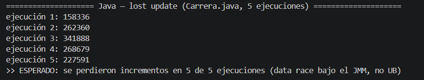

Rust `Rc` entre hilos — no compila (`error[E0277]`, `Rc` no es `Send`):

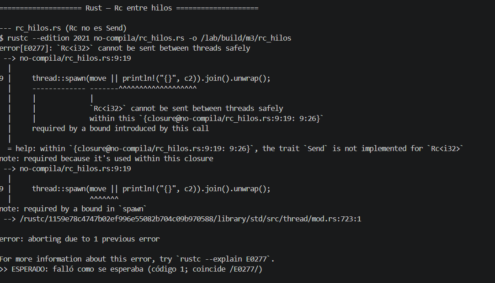

Rust dos `Mutex` — deadlock detenido por `timeout` (código 124):

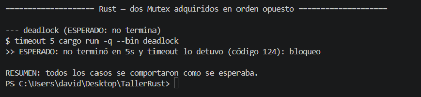

Correcciones verificadas — `AtomicInteger` da `400000` ×3 y el deadlock
corregido imprime "terminado sin deadlock" (código 0):

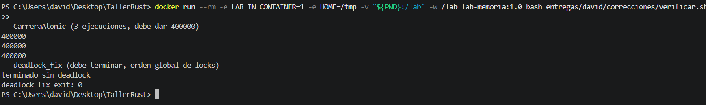

---

## 4. Reto de ingeniería

**Ruta elegida:** **D — soundness de `minivec`**

El defecto está en `MiniVec::get`:

```rust
pub fn get(&self, indice: usize) -> Option<&i32> {
    if indice <= self.len {                 // BUG: off-by-one
        unsafe { Some(&*self.ptr.as_ptr().add(indice)) }
    } else {
        None
    }
}
```

La condición usa `<=` en lugar de `<`. Con `indice == self.len`, `get` devuelve
`Some(&*ptr.add(len))`, es decir una referencia a la posición `len`, que **no
está inicializada** (invariante: solo `0..len` lo está) y puede estar fuera de la
capacidad reservada. Desde código **seguro** se puede provocar UB (lectura de
memoria no inicializada / fuera de los elementos válidos), así que la abstracción
**no es sound**.

**Test que expone el defecto** (solo API segura), en `minivec/tests/api.rs`:

```rust
#[test]
fn expone_el_defecto() {
    let mut v = MiniVec::new();
    v.push(1);
    v.push(2);
    // len == 2; el ultimo indice valido es 1. get(2) NO deberia leer memoria.
    // Con el bug (indice <= len) get(2) lee la posicion 2, no inicializada: UB.
    let fuera = v.get(v.len());         // get(2)
    assert_eq!(fuera, None);            // ademas falla logicamente: devuelve Some(basura)
}
```

`cargo test` normal puede pasar o fallar de forma no fiable (lee basura), pero
`cargo +nightly miri test -- --include-ignored` reporta **Undefined Behavior**.
Mensaje observado (`EVIDENCIAS/minivec-miri-antes.txt`):

```
test expone_el_defecto ... error: Undefined Behavior: reading memory at
alloc41376[0x8..0xc], but memory is uninitialized at [0x8..0xc], and this
operation requires initialized memory
...
Uninitialized memory occurred at alloc41376[0x8..0xc], in this allocation:
alloc41376 (Rust heap, size: 16, align: 4) {
    01 00 00 00 02 00 00 00 __ __ __ __ __ __ __ __
}
```

El volcado lo deja claro: los `i32` `1` y `2` están inicializados (`01..` y
`02..`) y a continuación hay bytes **no inicializados** (`__`); `get(2)` leyó
ahí. Tras la corrección, Miri ejecuta limpio: `4 passed; 0 failed`
(`EVIDENCIAS/minivec-miri-despues.txt`, salida con código 0).

**Corrección mínima:** cambiar `<=` por `<`.

```rust
/// Devuelve una referencia al elemento en `indice`, o `None` si no existe.
pub fn get(&self, indice: usize) -> Option<&i32> {
    if indice < self.len {
        // SAFETY: indice < len <= cap y las posiciones 0..len estan
        // inicializadas (invariante de la estructura), por lo que el puntero
        // apunta a un `i32` valido y vivo mientras dure `&self`.
        unsafe { Some(&*self.ptr.as_ptr().add(indice)) }
    } else {
        None
    }
}
```

Análisis con el criterio de profundidad:

1. **Propiedad deseada:** soundness — desde código seguro no debe poder
   provocarse UB a través de la API pública.
2. **Mecanismo que la impone o comprueba:** el contrato interno (la comprobación
   `indice < self.len`) respalda los bloques `unsafe`; los comentarios `// SAFETY:`
   documentan qué invariante justifica cada `unsafe`.
3. **Momento de detección:** el defecto original se detecta **en ejecución** con
   Miri (interpretación con modelo de memoria estricto); no lo detecta el
   compilador ni `cargo test` de forma fiable.
4. **Costo o limitación:** una comparación por acceso (igual que `Vec::get`);
   despreciable. Limitación: Miri solo cubre las ejecuciones que se le dan.
5. **Evidencia:** salida de Miri **antes** (UB) en
   `EVIDENCIAS/minivec-miri-antes.txt` y **después** (limpia, 4 tests ok) en
   `EVIDENCIAS/minivec-miri-despues.txt`; el cambio aplicado es `<=` → `<` en
   `MiniVec::get` (más comentarios `// SAFETY:` en cada bloque `unsafe` de
   `minivec/src/lib.rs`).

**Evidencias visuales.**

Miri **antes** del fix: reporta Undefined Behavior (memoria no inicializada):

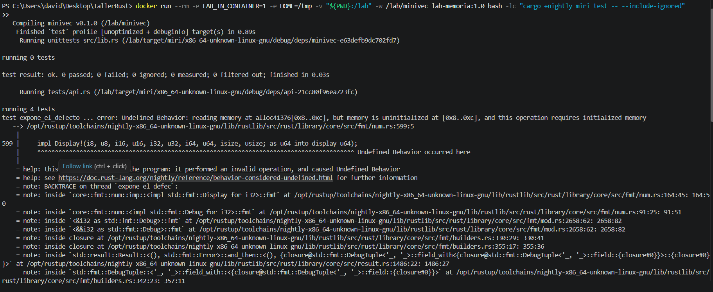

Miri **después** del fix: `4 passed; 0 failed`:

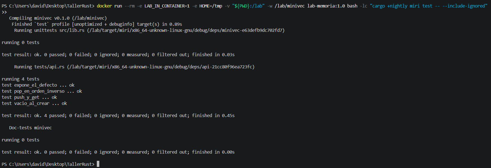

**¿Por qué una ejecución limpia de Miri no demostraría soundness?** Miri es un
intérprete dinámico: comprueba las rutas y entradas que efectivamente se
ejecutan. Si un test no ejerce cierto camino (por ejemplo un `indice` concreto,
un patrón de `push`/`pop`, un tamaño que dispare `crecer`), un UB latente ahí no
se observa. La soundness es una propiedad **universal** ("para toda ejecución
posible"), y eso exige razonar sobre los invariantes de la estructura, no solo
correr Miri. Miri refuta soundness (encuentra UB) pero no la prueba.

**Prueba adicional que se necesitaría:** pruebas de propiedad / fuzzing (p. ej.
`proptest` o `cargo fuzz`) sobre secuencias arbitrarias de `push`/`pop`/`get`
ejecutadas bajo Miri, y una revisión manual de los invariantes (`len <= cap`,
`0..len` inicializado) en cada método `unsafe`.

---

## 5. Preguntas de reflexión

**1. Diferencia entre UB en C, panic en Rust y excepción en Java.**
El UB de C no tiene significado definido: el compilador puede optimizar
asumiendo que no ocurre, y el resultado varía con compilador, optimización y
ejecución (puede imprimir basura, crashear o "funcionar" por azar). El panic de
Rust y la excepción de Java son **deterministas y seguros en memoria**: abortan
(o se propagan) en un punto definido sin corromper el estado. No son
equivalentes porque UB rompe toda garantía (incluida la de seguridad), mientras
panic/excepción son mecanismos **controlados** de fallo.

**2. Qué detecta Rust que Java no, y qué detecta Rust solo en ejecución.**
En compilación, el borrow checker de Rust rechaza el uso tras move (E0382) y la
mutación durante iteración (E0502) — Java no lo detecta en compilación (lo
descubre en runtime como `ConcurrentModificationException`, o no lo detecta en el
caso del move porque no tiene propiedad). Rust detecta solo en **ejecución** las
violaciones de préstamo de `RefCell` (`BorrowMutError`) y los índices dinámicos
fuera de rango (panic).

**3. Garantías de cada modelo y qué depende aún de disciplina o runtime.**
- **C:** casi todo depende de la disciplina del equipo y de herramientas
  externas (ASan/UBSan/TSan, revisión). El lenguaje da control, no garantías.
- **Java:** garantiza gestión automática de memoria y comprobación de límites en
  runtime; dependen de la disciplina los errores lógicos, la retención de
  objetos (fugas), las data races y los deadlocks.
- **Rust:** garantiza en compilación (código seguro) ausencia de use-after-free,
  doble free, data races y aliasing mutable; dependen del runtime los préstamos
  de `RefCell` y los índices dinámicos, y dependen de la disciplina las fugas,
  los deadlocks, la corrección lógica y la soundness de los bloques `unsafe`.

**4. Por qué los sanitizers/Miri ayudan pero no demuestran ausencia de defectos.**
Son herramientas **dinámicas**: solo observan las ejecuciones, entradas y caminos
que efectivamente se corren. Un defecto en un camino no ejercitado no se reporta.
Demostrar ausencia requiere cobertura exhaustiva (imposible en general) o prueba
formal/razonamiento sobre invariantes. "No reportó nada" significa "no se halló
en lo ejecutado", no "no existe".

**5. Cuándo preferir borrowing frente a clonar.**
Borrowing cuando solo se necesita **leer o mutar temporalmente** sin tomar
propiedad: es O(1), sin asignación, y expresa la dependencia de tiempo de vida.
Clonar cuando se necesitan **valores independientes** con vidas o mutaciones
separadas, o para romper una restricción de préstamo que complica el diseño. El
trade-off es coste (asignación + copia en clonar) frente a acoplamiento de vidas
y complejidad de lifetimes (en borrowing).

**6. Diferencia entre evitar data races y evitar deadlocks (con Exp. 3).**
Evitar **data races** es garantizar que no haya accesos concurrentes
no sincronizados a la misma memoria: Rust lo asegura en compilación (rechaza `Rc`
entre hilos por no ser `Send`, exige `Mutex`/atómicos). Evitar **deadlocks** es
un problema de **orden de adquisición** de recursos, que el sistema de tipos no
resuelve: el ejemplo `deadlock.rs` es memory-safe y libre de data races, y aun
así se bloquea; se corrige con un orden global de locks, no con el compilador.
Son propiedades distintas: la primera es de seguridad de memoria, la segunda de
*liveness*.

**7. Riesgos que permanecen en Rust con `unsafe` o FFI, y mitigación.**
Dentro de `unsafe` el programador asume contratos que el compilador no verifica:
punteros colgantes, aliasing mutable, lectura de memoria no inicializada
(como el bug de `minivec`), violación de invariantes de tipos de la FFI,
`Send`/`Sync` incorrectos. Mitigación en un proyecto real: minimizar y encapsular
`unsafe` tras APIs seguras y *sound*; documentar cada bloque con `// SAFETY:` y
cada `unsafe fn` con `# Safety`; probar con Miri, `proptest`/fuzzing y ASan/TSan;
revisar a cuatro ojos; y en FFI, validar punteros, tamaños y tiempos de vida en
la frontera.

**8. Elegir entre C, Rust y Java para latencia predecible y control de recursos.**
Factores: el **GC de Java** introduce pausas que afectan la latencia *cola*
(p99/p999), aunque GCs modernos (ZGC/Shenandoah) las reducen; conviene medirlas.
**C y Rust** no tienen GC y dan control de memoria y *layout*, con latencia más
predecible; Rust añade seguridad de memoria en compilación sin coste en runtime
sobre C, a cambio de mayor coste de desarrollo y de la carga de `unsafe` donde
haga falta bajo nivel. No asumir que un lenguaje "siempre es más rápido":
**evidencia adicional necesaria** antes de recomendar arquitectura: benchmarks
representativos de la carga real, perfiles de latencia de cola, medición de
asignaciones y pausas de GC, pruebas de concurrencia bajo sanitizers, y costo de
mantenimiento/experiencia del equipo.

---

## 6. Conclusión ejecutiva

Para un servicio con **latencia predecible y control estricto de recursos**
—por ejemplo un proxy o motor de datos de alto rendimiento— recomiendo **Rust**.
El laboratorio muestra que elimina en compilación clases enteras de fallos que en
**C** son comportamiento indefinido (índice fuera de rango en `indice.c` con
ASan; data race en `carrera.c` con TSan) y que en **Java** aparecen tarde o se diluyen (índices y
`ConcurrentModificationException` en runtime, data races no-UB pero incorrectas,
y retención de objetos más pausas de GC, como en `CacheEstatico`). Rust lo
consigue sin recolector de basura, lo que favorece la latencia de cola y el
control del *layout* de memoria.

Los **trade-offs** son reales y están respaldados por evidencia del taller: Rust
no es infalible. Sus garantías terminan en `RefCell` (panic en runtime, no prueba
estática), en los **deadlocks** (`deadlock.rs` es seguro en memoria y aun así no
termina), en las **fugas** (ciclos de `Rc`) y en el código `unsafe`, donde el bug
de soundness de `minivec` solo lo reveló Miri; y una ejecución limpia de Miri no
demuestra ausencia de UB. Se suma un costo de desarrollo mayor (lifetimes, curva
de aprendizaje). **Java** sigue siendo buena elección cuando la productividad y
el ecosistema pesan más que la latencia de cola, y **C** cuando hay que
interoperar con bases heredadas asumiendo la verificación externa. La
recomendación de Rust es, por tanto, condicionada al contexto y a confirmarse con
benchmarks de la carga real y perfiles de latencia, no un absoluto de
rendimiento.
